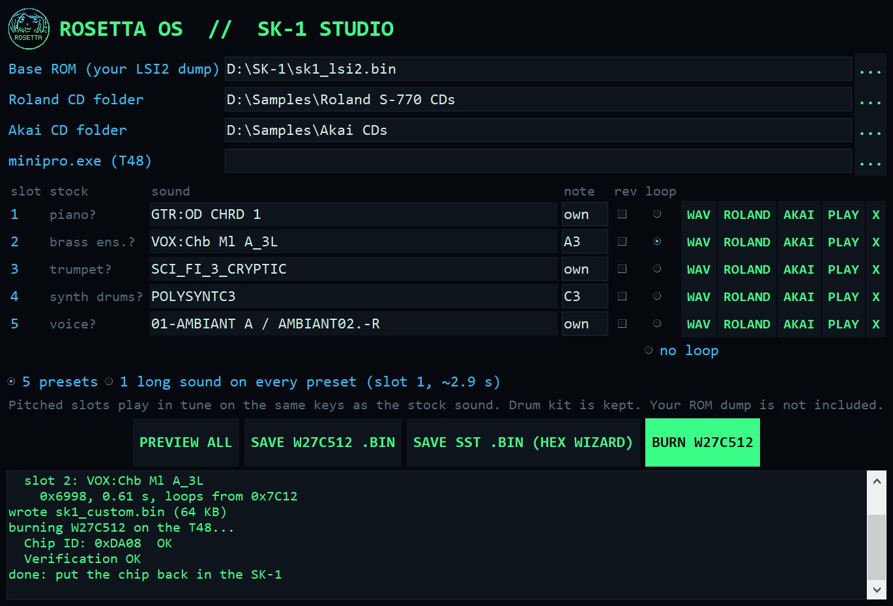
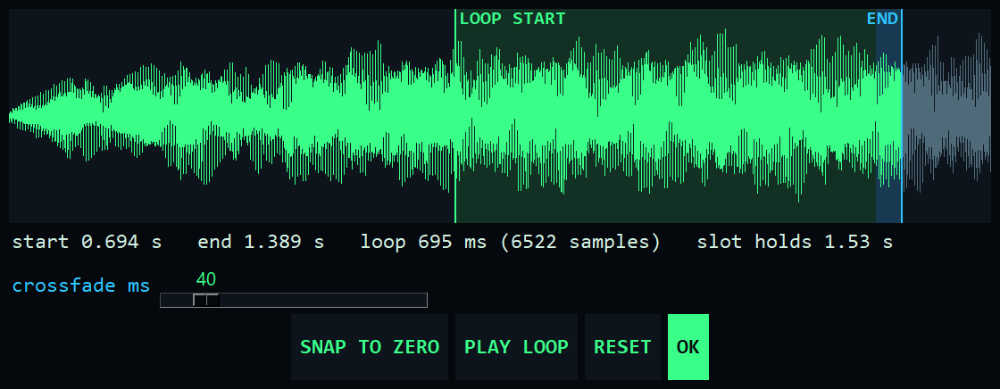

<p align="center"></p>

# Casio SK-1 Rosetta OS

Own sounds in the **Casio SK-1** (also sold as the Realistic Concertmate-500), the 1985 sampling keyboard: replace its preset ROM with an EEPROM and fill it with your own sounds from WAVs, Roland S-770 CDs or Akai S1000 CDs.

**Works on hardware:**
- a Winbond W27C512 in the ROM socket, no other mods
- one 3.2 s sound filling the whole ROM, played at full length (the stock presets are 0.4-0.9 s)
- 5 custom presets (guitar, voices, synth, FX) built and burned
- **custom loop points**: a held key sustains forever on our own loop

## SK-1 Studio

<p align="center"></p>

- **5 preset slots**, one per SK-1 PCM preset. Fill each from:
  - a **WAV**
  - a **Roland S-760/S-770 CD** image
  - an **Akai S1000/S3000 CD** image (.iso / .nrg)
- **Pitched to the slot:** type the sample's note (A4, C#3...) and it lands in tune on the same keys as the stock sound it replaces. `own` keeps its speed (FX, chords).
- **Reverse** any slot.
- **Loop** one slot, with a waveform **loop editor** (EDIT LOOP):
  - drag LOOP START and END on the waveform
  - SNAP TO ZERO puts both on zero crossings
  - set the crossfade (0-300 ms)
  - PLAY LOOP to audition it before burning

  The looping slot always ends exactly at the end of the ROM, where the SK-1 jumps back to the loop start.

<p align="center"></p>

- **1 long sound** mode: one ~2.9 s sound on every preset.
- **PLAY / PREVIEW ALL:** hear the slots exactly as the SK-1 will (8-bit, 9387 Hz) before burning.
- **SAVE** a 64 KB image for a W27C512, or 512 KB for an SST39SF040 (Hex Wizard).
- **BURN W27C512** straight to an XGecu T48 through minipro.
- The stock **drum kit is kept**, so the rhythms still work.

### Run it

```bash
pip install numpy scipy
pythonw tools/sk1studio.pyw
```

Windows (Python 3.10+). Set the paths once at the top: your own ROM dump, your Roland / Akai CD folders, `minipro.exe`. They're remembered in `~/.sk1studio.json`.

## The hardware mod

- Desolder LSI2 (the NEC D23C256EAC-011, right next to the two D4168C RAMs) and fit a 28-pin socket.
- **W27C512:** jumper its pin 1 to GND or 5 V. The images hold the same ROM twice, so either works.
- **W27C256-style 32 KB chip:** jumper pin 1 (VPP) to pin 28 (5 V).
- Pin 22 (OE) is already wired to ground on the board (a wire link), so it's a drop-in.
- Never program the W27C512 in the socket: it needs 12-14 V on pin 22, and that pin is grounded on the board.

### SST39SF040 (DIP-32, Hex Wizard) in the 28-pin socket
Seat it bottom-aligned: SST pins 3-30 go into socket pins 1-28, and pins 1, 2, 31, 32 hang out past the socket.
- SST pin 32 (VCC) → pin 30. Pin 30 sits on socket pin 28 (5 V), so A17 is high, which is fine.
- SST pin 31 (WE#) → 5 V.
- SST pins 1, 2, 3 (A18, A16, A15) → GND, or a switch for banks.

## Dump your own ROM

The ROM is Casio's code and isn't included. Read your own chip:

```bash
minipro -p "AM27C256@DIP28" -x -r sk1_lsi2.bin
```

A good dump has CRC32 `d615963c` (SHA1 `0dbf2d1c4c776f1a1c35dd2be4d6ca03882afd4c`). A plain 27C256 read works; no adapter needed.

## What we know about the SK-1

- **CPU:** MSM6283-01GS, an OKI-made Casio custom. Its program lives inside the chip. The external ROM is **only data**: tables + sounds, no CPU code (checked byte by byte, see [ROM_MAP.md](ROM_MAP.md)).
- **ROM layout:**
  - 0x0000-0x0AFF: tone records, envelope curves, the 13 envelopes, rhythms, demo song, the sample table (0x085C)
  - 0x0B00-0x0FFF: the drum kit
  - 0x1000-0x7FFF: the 5 PCM presets
- **Sounds:** 8-bit unsigned, 9387 Hz. A sound plays until an `FF FF` marker on an even address, so lengths are free.
- **Loops (confirmed on hardware):** a sound without an end marker runs to 0x7FFF, and the CPU jumps back to the address in table entry 8 (stock 0x7EB2) for as long as the key is held. There's one loop for the whole ROM, so one looping preset.
- **Slot order:** which preset button reads which table entry is a best guess from the stock sounds, not confirmed yet.
- **Sampling:** the SK-1's own sampler stays at 1.4 s. That limit is in the CPU. A slower clock gives longer, lo-fi samples; see [CLOCK_MOD.md](CLOCK_MOD.md).
- **Bus timing:** the sister model's service manual shows the CPU waits about 410 ns for memory data at the SK-1's clock, so any 200 ns or faster ROM/RAM is fine. See [CPU_RESEARCH.md](CPU_RESEARCH.md).

## Command-line tools

| Tool | Does |
|---|---|
| `tools/sk1studio.pyw` | the GUI |
| `tools/sk1rom.py` | WAV → ROM from the command line: `one-long`, `slots`, `slots-switch`, `rev:` prefix to reverse |
| `tools/roland_presets.py` | the 5-preset Roland/WAV build used on hardware |
| `tools/probe1.py`, `probe5.py` | probe ROMs: button map + loop test, sample-pointer test |
| `tools/roland.py`, `tools/akai.py` | Roland S-7xx / Akai S1000 CD readers (from U110 RomHex Studio) |

## Docs

- [ROM_MAP.md](ROM_MAP.md): the ROM, byte by byte
- [CPU_RESEARCH.md](CPU_RESEARCH.md): what's known about the MSM6283, from both service manuals
- [CLOCK_MOD.md](CLOCK_MOD.md): faster / slower clock
- [CONTEXT.md](CONTEXT.md): memory map, pinouts, early notes
- SK-1 service manual + user manual: [polynominal.com/casio-sk-1](https://www.polynominal.com/casio-sk-1/index.html)

## Credits

- **yuyoi:** hardware, dumping, testing, sound picks
- MAME `sk1.cpp` (Vas Crabb): ROM hashes
- circuitbenders.co.uk forum: MSM6283 pin list
- Jonas Karlsson: SK-1 octave clock mod
- Roland / Akai CD readers from [U110 RomHex Studio](https://github.com/yuyoi/u110-romhex-studio)
- Built with Claude Code
